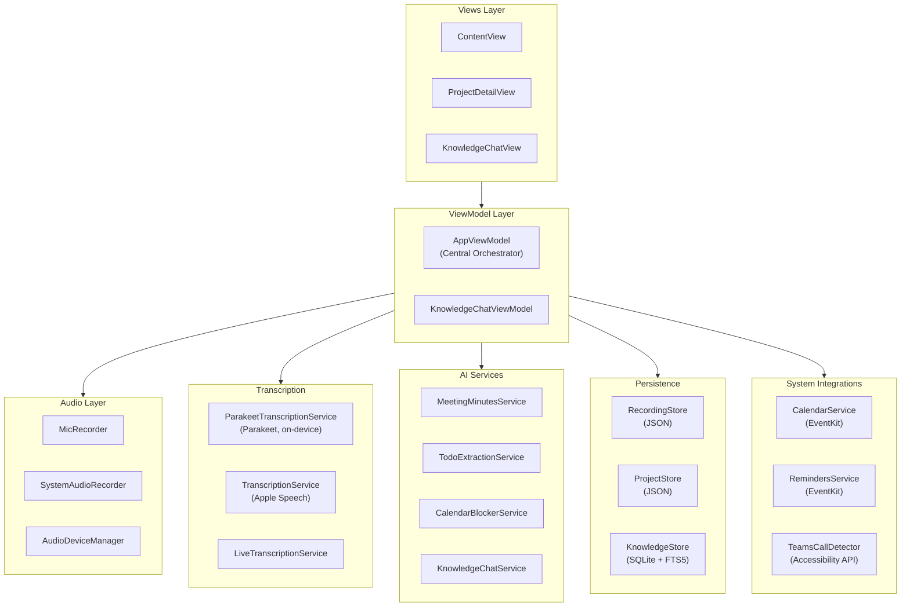
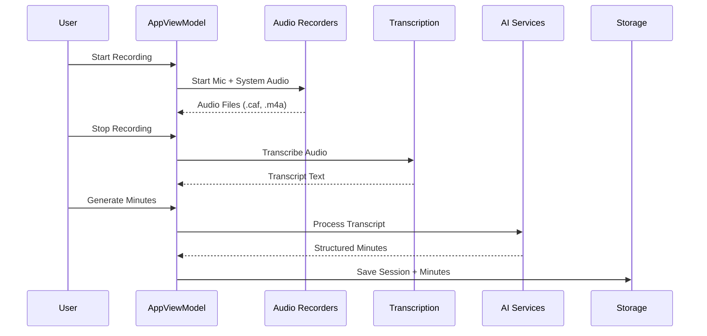

# MinuteMind

A macOS application for recording meetings, generating AI-powered transcriptions, and automatically producing structured meeting minutes.


## Install

Paste this into Terminal (macOS 14 or newer, Apple Silicon):

```bash
curl -fsSL https://raw.githubusercontent.com/Robschke/MinuteMind/main/install.sh | bash
```

It downloads the latest release into `/Applications` (or updates MinuteMind where it is already installed) and installs [Claude Code](https://claude.com/claude-code) if it is missing. Project workspaces need git: if Apple's Command Line Tools are not installed yet, the installer opens Apple's installer for them (or run `xcode-select --install` yourself). Run the same command again to update.

MinuteMind runs the official Claude Code CLI on your Mac. You sign in to Claude Code yourself, with your own Claude account, through Anthropic's sign-in; MinuteMind never sees your credentials. Your use of Claude is subject to [Anthropic's terms](https://code.claude.com/docs/en/legal-and-compliance).

> **Not affiliated with Anthropic.** MinuteMind is an independent open-source project. It is not built, endorsed or sponsored by Anthropic. "Claude" and "Claude Code" are trademarks of Anthropic, PBC.

> **Recording consent.** Many countries require the consent of everyone in a conversation before it is recorded (in Germany, for example, §201 StGB). You are responsible for getting that consent before you record a meeting with MinuteMind.

## Features

| Feature | Description |
|---------|-------------|
| **Dual-Channel Recording** | Simultaneously records microphone and system audio |
| **Smart Transcription** | NVIDIA Parakeet (on-device, default) + Apple Speech |
| **AI Meeting Minutes** | Generates structured summaries, decisions, and action items |
| **Local & Cloud AI** | OpenAI, Azure OpenAI, or local models via Ollama (Mistral, Llama, etc.) |
| **Knowledge Base** | Searchable repository with FTS5 full-text search |
| **Todo Extraction** | AI-powered task extraction with assignees and due dates |
| **Calendar Blocking** | AI-suggested time blocks for tasks |
| **Apple Integrations** | Syncs with Reminders and Calendar apps |
| **Teams Detection** | Auto-detects Microsoft Teams calls via Accessibility API |

---

## Architecture



### Data Flow



---

## Project Structure

```
Sources/App/
├── MinuteMindApp.swift          # App entry point
├── Audio/
│   ├── AudioDeviceManager.swift # Device enumeration
│   ├── MicRecorder.swift        # Microphone recording
│   └── SystemAudioRecorder.swift# System audio capture
├── Components/
│   ├── DesignSystem.swift       # UI theme & tokens
│   ├── FilterChip.swift         # Filter UI component
│   ├── SkeletonView.swift       # Loading placeholders
│   ├── StatusBadge.swift        # Status indicators
│   └── TranscriptCard.swift     # Transcript display
├── Config/
│   ├── OpenAIProfiles.swift     # API credential profiles
│   └── OpenAIProfilesStore.swift# Profile persistence
├── Models/
│   ├── ChatSession.swift        # Chat history model
│   ├── FileAttachment.swift     # Attachment model
│   ├── KnowledgeEntry.swift     # Knowledge base entry
│   ├── Project.swift            # Project & Task models
│   └── RecordingSession.swift   # Recording session model
├── Services/
│   ├── CalendarBlockerService.swift   # AI calendar suggestions
│   ├── CalendarService.swift          # EventKit calendar
│   ├── EmbeddingService.swift         # OpenAI embeddings
│   ├── FileParserService.swift        # Document parsing
│   ├── FileWatcher.swift              # File system monitoring
│   ├── KnowledgeBaseTool.swift        # AI tool definition
│   ├── KnowledgeChatService.swift     # RAG chat service
│   ├── KnowledgeExtractionService.swift# Extract from minutes
│   ├── MeetingMinutesService.swift    # Generate minutes
│   ├── OllamaService.swift            # Local model management
│   ├── RemindersService.swift         # Apple Reminders sync
│   ├── TeamsCallDetector.swift        # Teams call detection
│   └── TodoExtractionService.swift    # AI task extraction
├── Store/
│   ├── ChatHistoryStore.swift   # Chat persistence
│   ├── KnowledgeStore.swift     # SQLite knowledge DB
│   ├── ProjectStore.swift       # Project persistence
│   └── RecordingStore.swift     # Session persistence
├── Transcription/
│   ├── LiveTranscriptionService.swift # Real-time transcription
│   └── TranscriptionService.swift     # Apple Speech API
├── ViewModels/
│   ├── AppViewModel.swift       # Main app state (1400+ lines)
│   ├── KnowledgeChatViewModel.swift   # Chat UI state
│   └── KnowledgeSearchViewModel.swift # Search UI state
└── Views/
    ├── AllTranscriptsView.swift       # Transcript list
    ├── ContentView.swift              # Main container
    ├── ImportPreviewView.swift        # File import
    ├── KnowledgeChatView.swift        # AI chat interface
    ├── KnowledgeSearchView.swift      # Knowledge search
    ├── MeetingMinutesSettingsView.swift# Settings window
    ├── ProjectDetailView.swift        # Project management
    └── ProjectsSidebarView.swift      # Sidebar navigation
```

---

## Core Components

### Audio Recording

| Component | Purpose |
|-----------|---------|
| `MicRecorder` | Records microphone input to `.caf` format |
| `SystemAudioRecorder` | Captures system audio to `.m4a` format |
| `AudioDeviceManager` | Enumerates and manages audio devices |

### Transcription

| Service | Technology | Use Case |
|---------|------------|----------|
| `ParakeetTranscriptionService` | NVIDIA Parakeet TDT v3 (FluidAudio) | Default, on-device, multilingual |
| `TranscriptionService` | Apple Speech Framework | On-device, offline capable |
| `LiveTranscriptionService` | Apple Speech | Real-time transcription |

### AI Services

| Service | Function |
|---------|----------|
| `MeetingMinutesService` | Generates structured meeting minutes from transcripts |
| `TodoExtractionService` | Extracts tasks with assignees, due dates, priorities |
| `CalendarBlockerService` | Suggests optimal time blocks for tasks |
| `KnowledgeChatService` | RAG-powered chat with tool calling for knowledge search |
| `EmbeddingService` | Generates embeddings for semantic search |
| `OllamaService` | Manages local AI models (download, status, inference) |

**Note:** All AI services support OpenAI, Azure OpenAI, and local Ollama models interchangeably.

### Storage

| Store | Backend | Purpose |
|-------|---------|---------|
| `RecordingStore` | JSON (`sessions.json`) | Recording sessions |
| `ProjectStore` | JSON | Projects and tasks |
| `KnowledgeStore` | SQLite + GRDB | Knowledge entries with FTS5 search |
| `ChatHistoryStore` | JSON | Chat conversation history |

---

## Data Models

### RecordingSession

```swift
struct RecordingSession {
    let id: UUID
    var title: String
    var status: Status         // idle, recording, transcribing, completed, failed
    var micFileName: String?
    var systemFileName: String?
    var transcript: Transcript?
    var meetingMinutesFileName: String?
    var projectID: UUID?
}
```

### Project & ProjectTask

```swift
struct Project {
    let id: UUID
    var name: String
    var colorHex: String
}

struct ProjectTask {
    let id: UUID
    var projectID: UUID
    var title: String
    var assignee: String?
    var dueDate: Date?
    var priority: TaskPriority?  // low, medium, high, critical
    var reminderID: String?      // Apple Reminders sync
    var calendarBlockerIDs: [String]
}
```

### KnowledgeEntry

```swift
struct KnowledgeEntry: FetchableRecord, PersistableRecord {
    var id: Int64?
    var content: String
    var category: String
    var sourceMeetingID: UUID
    var embedding: [Double]?     // For semantic search
    var attachments: [FileAttachment]?
}
```

---

## Configuration

### OpenAI Profiles

The app supports multiple AI provider profiles for flexibility:

```swift
struct OpenAICredentialProfile {
    var provider: OpenAIProvider  // .openAI, .azure, or .ollama
    var apiKey: String           // Optional for local models
    var baseURL: String
    var model: String            // e.g., "gpt-4o-mini", "mistral:7b"
    var azureDeployment: String  // For Azure OpenAI
    var prompts: [SystemPrompt]  // Custom system prompts
}
```

**Supported Providers:**
- **OpenAI**: Cloud-based GPT models (requires API key)
- **Azure OpenAI**: Enterprise OpenAI service (requires API key)
- **Ollama (Local)**: Run models locally on your Mac (no API key needed)
  - Mistral 7B/8B: Fast, efficient, ~4-5 GB
  - Llama 2/3: Meta's open models
  - Qwen 2.5: Alibaba's multilingual models
  - CodeLlama: Specialized for coding

**Using Local Models:**
1. Install Ollama: `brew install ollama` or from [ollama.ai](https://ollama.ai)
2. Open Settings → Add "Mistral 8B" profile (or create custom)
3. Click "Download Model" button
4. Watch progress bar - model downloads in background
5. Once complete, use it for all AI features

Models are cached and reused - no re-download needed.

Profiles are stored in the app's Application Support directory.

---

## Developer Workflows

### Prerequisites

- macOS 14.0+
- Swift 6.2+
- Xcode 16+ (for IDE support)

### Build

```bash
# Development build
swift build

# Release build
swift build -c release
```

### Test

```bash
swift test
```

Tests use the `swift-testing` framework and cover:
- Model serialization/deserialization
- Todo extraction parsing
- Knowledge base operations
- Calendar blocker service

### Run

```bash
# Build and run directly
swift run MinuteMind

# Or build app bundle
./Scripts/package_app.sh
open dist/MinuteMind.app
```

### Package for Distribution

```bash
# Create app bundle
./Scripts/package_app.sh

# Create DMG (optional)
./Scripts/create_dmg.sh
```

The packaged app will be in `dist/MinuteMind.app`.

### Release

```bash
# Build dist/MinuteMind.zip and publish it as a GitHub Release for the version in Info.plist
./Scripts/package_release.sh --publish
```

Bump `CFBundleShortVersionString` in `Sources/App/Supporting/Info.plist` first. `install.sh` always downloads `MinuteMind.zip` from the latest release.

---

## System Permissions

The app requires the following permissions:

| Permission | Purpose |
|------------|---------|
| **Microphone** | Audio recording |
| **Screen Recording** | System audio capture |
| **Speech Recognition** | Apple Speech transcription |
| **Accessibility** | Teams call detection |
| **Calendars** | Time blocker creation |
| **Reminders** | Task sync |

---

## Dependencies

| Package | Purpose |
|---------|---------|
| [GRDB.swift](https://github.com/groue/GRDB.swift) | SQLite database with FTS5 |
| [swift-testing](https://github.com/apple/swift-testing) | Modern testing framework |

---

## File Storage

All data is stored in `~/Library/Application Support/MinuteMind/`:

```
MinuteMind/
├── sessions.json          # Recording sessions
├── projects.json          # Projects and tasks
├── openai-profiles.json   # API configurations
├── knowledge.sqlite       # Knowledge base
├── Recordings/            # Audio files
├── Transcripts/           # Transcript text files
└── MeetingMinutes/        # Generated minutes
```

---

## License

MIT License, see [LICENSE](LICENSE) for details. The open-source packages MinuteMind builds on are listed with their licenses in [THIRD_PARTY_NOTICES.md](THIRD_PARTY_NOTICES.md).
